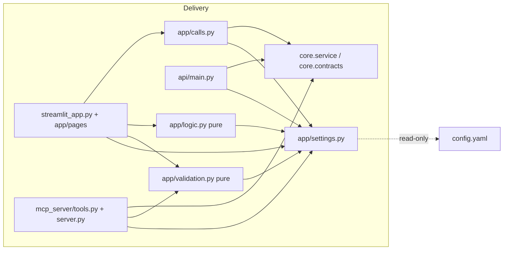
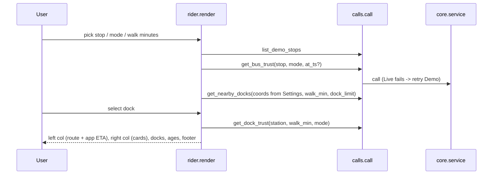

# Design Document

## Overview

The delivery layer (Streamlit app, FastAPI `/v1`, FastMCP server) extends the existing shell in `streamlit_app.py` and `app/`. Everything is a thin view over `core.service` and `core.contracts`. All judgment-free presentation rules (status words, chance text, hindsight badges, age and time formatting, input validation) live in pure modules so they can be property-tested.

Key decisions:
- **One shared Settings module** (`app/settings.py`, no Streamlit import) feeds app, API and MCP. Bounds, routes, coordinates and legal strings are defined once. (R7, R8, R9, R11)
- **One service-call helper** turns exceptions into typed results, so every view handles `NotFound`, `LiveDataUnavailable` and unexpected errors the same way, and the Live to Demo fallback lives in one place. (R3)
- **Footer moves to `streamlit_app.main()`**, so Disclaimer and Attribution render on every page in every state, including error states. (R7.1, R7.8)
- **`DemoStop` has no coordinates**, so demo stop coordinates come from Settings, keyed by `stop_id`. (R2.1)

## Architecture



Import rule: from `core/`, only `core.service` and `core.contracts` (R11.1). `app/settings.py`, `app/logic.py`, `app/validation.py` import no Streamlit, so API and MCP can use them without pulling in the UI. `app/__init__.py` stays docstring-only for the same reason.

### Module layout

| Path | Status | Purpose |
|---|---|---|
| `app/settings.py` | new | Defaults, optional `config.yaml` override, shared strings; holds the generated `DEMO_STOP_COORDS` block and `mbta_api_base_url` |
| `scripts/fetch_demo_coords.py` | new | One-time script that fills the `DEMO_STOP_COORDS` block; never imported by runtime code |
| `app/logic.py` | new | Pure presentation functions |
| `app/validation.py` | new | Pure input validators shared by MCP and the walk-minutes input |
| `app/calls.py` | new | Service-call wrapper, typed results, Live to Demo fallback |
| `app/rider.py` | extend | Replace sample data with live service data, replay, docks |
| `app/operator.py` | extend | Findings and health |
| `app/api_mcp.py` | extend | Docs built from Settings |
| `app/about.py` | extend | Guardrails, evals, observability, limits, roadmap, statuses |
| `app/components.py` | extend | `status_card` gains badge and chance args; add small table/metric helpers; `footer` unchanged |
| `app/theme.py` | extend | `DISCLAIMER`/`ATTRIBUTION` re-exported from Settings (single source); colors unchanged |
| `streamlit_app.py` | extend | Calls `footer()` after the page; session defaults (Demo) |
| `api/main.py`, `api/models.py` | new | App factory, routes, envelope, handlers, CORS |
| `mcp_server/tools.py`, `mcp_server/server.py` | new | Plain tool functions (testable) and FastMCP registration |

## Components and Interfaces

### app/settings.py

Frozen dataclass `Settings` plus module-level `SETTINGS = load_settings()`. Module constants `DISCLAIMER` and `ATTRIBUTION` are the glossary strings, word for word.

| Key | Default (proposed) | Used by |
|---|---|---|
| `demo_stop_coords` | filled by `scripts/fetch_demo_coords.py` (may be empty until the script runs) | Rider docks |
| `mbta_api_base_url` | `https://api-v3.mbta.com` | `scripts/fetch_demo_coords.py` only |
| `api_base_url` | `http://localhost:8000` | API_MCP page |
| `api_routes` | `{bus_trust, dock_trust, nearby_docks, findings, health, replay_window}` to `/v1/...` paths | API, API_MCP page |
| `mcp_tools` | the five tool names | MCP server, API_MCP page |
| `cors_origins` | `[]` (no CORS headers) | API |
| `replay_play_speed` | `60` | Replay |
| `walk_min` | `{default: 5, min: 1, max: 30}` | Rider, API, MCP |
| `dock_limit` | `3` | Rider |
| `limit` | `{default: 5, min: 1, max: 20}` | API, MCP |
| `display_tz` | `America/New_York` | `logic` time formatting |
| `modes` | `("live","demo","replay")` | All |

`load_settings(config_path=None)`: `yaml.safe_load` the file read-only; for each key in the defaults table whose name also appears at the top level of `config.yaml`, use that value (nested dicts merged key by key, wrong types ignored). Unknown keys are ignored. Never writes. Defaults for walk and limit values match the service defaults (`walk_min=5`, dock `limit=3`, bus `limit=5`); min/max are proposals. (R11.5, R11.6)

### scripts/fetch_demo_coords.py (one-time, B-owned)

Run once with `uv run python scripts/fetch_demo_coords.py`. No runtime code imports it, and the App, API and MCP_Server never call the MBTA API (R11.11).

1. Stop ids come from `core.service.list_demo_stops()`; the base URL from `SETTINGS.mbta_api_base_url`.
2. `MBTA_API_KEY` is read from `.env` with `python-dotenv`. It is sent as header `x-api-key` only when present, and is never logged or printed.
3. For each stop id, `GET {base}/stops/{stop_id}` (using `httpx`, already a dependency); take `data.attributes.latitude` and `longitude`.
4. Print the id, latitude and longitude, then rewrite only the text between `# BEGIN DEMO_STOP_COORDS` and `# END DEMO_STOP_COORDS` in `app/settings.py`; all other bytes stay unchanged.
5. If any request fails, or any stop lacks a numeric latitude or longitude, exit non-zero with a clear error and write nothing.

Until the script runs, `demo_stop_coords` may be empty and docks show "dock data unavailable for this stop". No coordinate is guessed. (R11.9, R11.10)

### app/logic.py (pure; no I/O, clock, randomness or mutation)

```python
STATUSES = ("confirmed", "estimate", "unreliable")
def status_word(status: str) -> str | None          # "Confirmed" etc.; None if not displayable
def is_displayable(status: str) -> bool
def format_chance(chance: float | None, n: int, method: str) -> str
    # "96% (model, n=580)"; None -> "chance unavailable (n=580)"; placeholder adds the word "placeholder"
def hindsight_badge(outcome: str | None, replay_ts: float | None, app_eta_min: float | None) -> str | None
    # served -> "served"; canceled -> "canceled"; open -> "still open"
    # vanished -> "disappeared N min later" (N = max(0, round(app_eta_min))),
    #   or "disappeared before arrival" if replay_ts/app_eta_min is None or not finite
    # None/other -> None
def format_age(sec: int | None) -> str               # "unknown" | "45 s" | "5 min" | "3 h" | "2 d" (floor)
def parse_age(text: str) -> int | None               # inverse used by tests
def format_ny_time(ts: int | None) -> str            # "2026-01-10 14:05 EST"; zoneinfo, tz abbreviation always shown
def next_replay_ts(current: int, start: int, end: int, step: int) -> tuple[int, bool]
    # (min(current + step, end), finished)
def percent(x: float | None, places: int = 1) -> str  # "not available" when None
```

Note on "disappeared N min later" (R4.8): `app_eta_min` is already relative to the snapshot, so N is that value rounded, floor 0. `replay_ts` is only checked for presence and finiteness.

### app/validation.py (pure)

`validate_id`, `validate_mode`, `validate_int_in`, `validate_number_in`, `validate_lat`, `validate_lon`, `validate_at_ts`. Each returns the cleaned value or raises `InvalidInput(field, allowed)`. Bounds are read from `SETTINGS`. Used by MCP tools and the Rider walk-minutes input (R2.5, R9.2). The API uses FastAPI `Query(ge=, le=)` built from the same Settings values.

### app/calls.py

```python
@dataclass(frozen=True)
class CallResult[T]:
    ok: bool
    value: T | None
    kind: Literal["ok","not_found","live_unavailable","error"]
    mode_shown: str        # mode of the data actually displayed
    fell_back: bool        # True when Live failed and Demo data is shown
    message: str           # user-safe text, no exception detail
    missing_id: str | None # id for NotFound messages

def call(fn, *args, mode: str, **kwargs) -> CallResult
```

Behavior: call `fn(*args, mode=mode, **kwargs)`. `LiveDataUnavailable` with `mode=="live"` retries once with `mode="demo"` and returns `fell_back=True, mode_shown="demo"`. `NotFound` returns `kind="not_found"`, no fallback. Any other exception returns `kind="error"` with a generic message. No caching, so choosing Live again re-requests (R3.5). `at_ts` is only passed when not `None` (current `get_nearby_docks` has no `at_ts`, see Risks).

### Rider view (app/rider.py)

Session keys: `rider_stop`, `rider_mode` (default `"Demo"`), `walk_min`, `replay_ts`, `replay_playing`, `last_ok_replay_ts`, `selected_dock`.



- Stop picker options come from `list_demo_stops()` (name plus routes). No hardcoded stops.
- Left column "What the app shows": route and `app_eta_min` only. Right column: one `status_card` per displayable prediction, same order. Predictions where `is_displayable(status)` is false are dropped from both. `hidden_count` shown as a bare number.
- Card lines: `format_chance(...)`, `realistic_eta_min` as "low to high min", `why`, backup, hindsight badge (replay only).
- Data age line uses `format_age` for `trip_updates` and `vehicle_positions`; absent keys show "unknown".
- Docks: if `stop_id` has no entry in `demo_stop_coords`, show "dock data unavailable for this stop" and make no call. Hidden docks are filtered out. Selecting a dock calls `get_dock_trust` and lists backups (name + status word) or "no backup available".
- Not-found handling: a bus `NotFound` shows a message naming the id and no cards (R1.13, R3.6). A dock `NotFound` shows a dock message only and leaves the bus cards unchanged (R2.8).
- Walk minutes: `st.number_input` bound to `walk_min` Settings min/max/default, validated again with `validate_number_in`; invalid input keeps the last valid value and last dock list, shows the accepted range, makes no call.
- Active mode word (Live/Demo/Replay) from `CallResult.mode_shown`, shown next to every response. A fallback shows "Live data is unavailable. Showing Demo data."

### Replay

Replay mode builds the slider from `get_replay_window()` (min `start`, max `end`, step `step_sec`, initial `start`). The replay body is a fragment created dynamically so `run_every` can switch on and off:

```python
tick = step_sec / SETTINGS.replay_play_speed          # real seconds per step
frag = st.fragment(run_every=tick if playing else None)(replay_body)
frag()
```

`replay_body` order: read `replay_ts` from session state, then if playing set `ts, finished = next_replay_ts(...)`; fetch bus and docks with `mode="replay", at_ts=ts`; on error restore `last_ok_replay_ts`, set `replay_playing=False`, show "snapshot could not be loaded"; then render slider (key `replay_ts`), play button, results. When `finished`, set `replay_playing=False` and call `st.rerun()` once to drop `run_every`. All shown times use `format_ny_time`. If the window call fails, `n_snapshots == 0` or `end < start`, slider and play are disabled with "replay data is unavailable". Fragments with `run_every` work on Streamlit Cloud (websocket reruns, no extra services) and the pinned `streamlit>=1.66.1` supports them.

### Operator view (app/operator.py)

- `call(get_findings)` and `call(get_health)` are independent; one failing does not hide the other (R5.9, R6.3).
- If `is_placeholder`: top banner (`st.warning`) "not measured results", and the word "placeholder" in every table, chart and metric label (R5.7, R5.8).
- Tables: three vanish tables (status, uncertainty, route) with `percent(rate)` and n, in service order. Calibration: one table and one `altair` chart (predicted vs observed, n in tooltip); "not available" when empty. Model metrics at 3 decimals. ETA range/single hit as percentages with n. Least reliable docks list or "no data". Sample block "Saturday sample" = `sample_label`, NY window, train/test counts.
- Health: all values via a `show(value, fmt)` helper where `None` gives "not available" and `0` gives "0". Mode flags as "enabled"/"disabled".
- `Findings.generated_at` is converted to NY time. Footer comes from `main()`.

### API_MCP page and About page

- API_MCP: iterate `SETTINGS.api_routes` and `SETTINGS.mcp_tools`. An empty base URL or route is omitted with a message naming the missing setting. Example ids and coordinates come from the first `list_demo_stops()` entry and `demo_stop_coords`; if unavailable, examples are omitted with a message. Replaces the current hardcoded example block.
- About: sections Guardrails, Evals, Observability, Honest limits, Roadmap (names AWS), and a Statuses list for confirmed/estimate/unreliable/hidden with "hidden is never shown". Honest limits lists the four documented limitations from Open Questions and Risks (R12.2 to R12.4). If the page reads Findings it labels numbers placeholder when `is_placeholder`; otherwise it quotes no numbers.

### API (api/main.py)

`create_app()` builds the app; routes use paths from `SETTINGS.api_routes`.

| Route | Required params | Optional params (bounds from Settings) | Response |
|---|---|---|---|
| `GET /v1/bus-trust` | `stop_id` | `mode` (live/demo/replay, default demo), `limit`, `at_ts` (int >= 0) | `BusTrustResponse` |
| `GET /v1/dock-trust` | `station_id` | `walk_min`, `mode`, `at_ts` | `DockTrustResponse` |
| `GET /v1/nearby-docks` | `lat` (-90..90), `lon` (-180..180) | `walk_min`, `limit`, `mode`, `at_ts` | `Envelope[list[DockResult]]` |
| `GET /v1/findings` | none | none | `Envelope[Findings]` |
| `GET /v1/health` | none | none | `Health` |
| `GET /v1/replay-window` | none | none | `ReplayWindow` |

- `Envelope[T]`: `{"data": T, "attribution": [ATTRIBUTION], "disclaimer": DISCLAIMER}` (`api/models.py`). Health and replay-window return contract models unchanged; attribution and disclaimer are not required there.
- Validation runs before the handler body (FastAPI `Query` constraints, `mode` as a `Literal`), so the Service is never called on bad input.
- Error body for all errors: `{"error": "<code>", "message": "<text>", "params": [..]}` where `params` appears only for 422.

| Condition | Status | Body |
|---|---|---|
| Missing/out-of-bound param | 422 | `error=validation_error`, `params` lists each offending parameter name |
| `NotFound` | 404 | `error=not_found`, message names the id |
| `LiveDataUnavailable` | 503 | `error=live_unavailable`, "live data is unavailable" |
| Other exception | 500 | `error=internal_error`, generic text only |

- CORS: `CORSMiddleware(allow_origins=SETTINGS.cors_origins)` is added only when the list is non-empty; no wildcard and no credentials.
- Security note: the API is unauthenticated and read-only by design (public demo data). Called out in the About page limits.

### MCP server (mcp_server/tools.py, server.py)

`tools.py` holds plain functions that never raise and return dicts; `server.py` registers them on `FastMCP` using names from `SETTINGS.mcp_tools`. Read-only: no tool writes anything (R9.8).

| Tool | Signature | Service call |
|---|---|---|
| `list_demo_stops` | `()` | `list_demo_stops` |
| `check_bus_trust` | `(stop_id, mode="demo", limit=5, at_ts=None)` | `get_bus_trust` |
| `check_dock_trust` | `(station_id, walk_min=5, mode="demo", at_ts=None)` | `get_dock_trust` |
| `nearby_docks` | `(lat, lon, walk_min=5, limit=3, mode="demo", at_ts=None)` | `get_nearby_docks` |
| `todays_findings` | `()` | `get_findings` |

Validation (all through `app/validation.py`, before any Service call): ids are non-empty strings of 1 to 64 characters after trimming; `mode` in modes; `limit`, `walk_min` within Settings bounds; `lat` in -90..90; `lon` in -180..180; `at_ts` a non-negative integer. Booleans are rejected as numbers.

Result shapes:

```python
# success
{"ok": True, "data": <model_dump or list>, "data_age_sec": {...}, "attribution": [ATTRIBUTION], "disclaimer": DISCLAIMER}
# error
{"ok": False, "error": {"code": "invalid_input"|"not_found"|"live_unavailable"|"internal_error",
                        "field"?: str, "message": str}}
```

- `invalid_input`: names the field and allowed range/values.
- `not_found`: names the id. `live_unavailable`: suggests `demo` mode. `internal_error`: generic text, no trace; the server keeps serving.
- `data_age_sec`: bus tools use `BusTrustResponse.data_age_sec`; dock tools use `{"docks": last_reported_age_sec}` of the returned dock(s) (null when absent); findings and stops report `{}` because the Service reports no age for them (findings carry `generated_at`).

## Data Models

No new persisted data. New in-memory types: `Settings`, `CallResult`, `Envelope[T]`, `InvalidInput(field, allowed)`, and the MCP result dicts above. All payloads are the unchanged `core.contracts` models.

Fixed inputs the design relies on (from `demo_stops.json`): stops `place-haecl`, `place-neast`, `place-kencl`; these ids are looked up in `demo_stop_coords`, not hardcoded in views.


## Correctness Properties

*A property is a characteristic or behavior that should hold true across all valid executions of a system-essentially, a formal statement about what the system should do. Properties serve as the bridge between human-readable specifications and machine-verifiable correctness guarantees.*

Reflection: status rendering and the omit rule merge into one property; the 422 rule for API and MCP merge into one; 404/NotFound for API and MCP merge; 503/500 mappings merge. UI wiring criteria (R1.1-1.4, 2.1-2.3, 3.x, 4.1-4.2) are example tests, not properties.

### Property 1: Status is always shown as a word

For any string `s`, `status_word(s)` returns a non-empty text containing the status word (case-insensitive) when `s` is `confirmed`, `estimate` or `unreliable`, and `None` for every other string, so such predictions are omitted.

**Validates: Requirements 1.7, 1.8, 10.2**

### Property 2: Every chance shows its sample size

For any chance in [0.0, 1.0], integer n in [0, 1,000,000] and method in {model, empirical, placeholder}, `format_chance` output contains the decimal digits of n; for method `placeholder` it contains the word "placeholder"; for a chance of `None` it says the chance is unavailable and shows no percentage.

**Validates: Requirements 1.5, 1.6, 1.10, 10.3**

### Property 3: Hindsight badge is deterministic and honest

For any outcome and any finite minutes in [0, 1440] (or `None`/NaN/inf), `hindsight_badge` returns the same value on repeated calls and does not modify its inputs. It returns "served", "canceled", "still open" for those outcomes; for `vanished` it returns "disappeared N min later" with N = max(0, round(minutes)) when inputs are finite, else "disappeared before arrival"; it returns `None` for an absent or unknown outcome. The output never contains "ghost" or "proven" in any letter case.

**Validates: Requirements 4.6, 4.7, 4.8, 4.9, 4.10, 4.11, 4.12, 10.1, 10.4**

### Property 4: Data-age round trip

For any integer age in [0, 604,800], `parse_age(format_age(age))` is within one display unit (second, minute, hour or day, as shown) of `age`; `format_age(None)` is "unknown".

**Validates: Requirements 1.11, 10.5**

### Property 5: New York times carry a zone abbreviation

For any POSIX timestamp, `format_ny_time` returns text ending in `EST` or `EDT`, and the abbreviation matches the real zone offset at that instant.

**Validates: Requirements 4.5**

### Property 6: Replay advance is bounded and terminates

For any `start <= current <= end` and `step > 0`, `next_replay_ts` returns a value in [current, end], advances by exactly `step` unless that would pass `end`, and reports `finished` exactly when the result equals `end`. Repeated application reaches `end` in finitely many steps.

**Validates: Requirements 4.3, 4.4**

### Property 7: Missing values read "not available", zero stays zero

For any optional number, the display helper returns "not available" for `None` and a text containing the digit "0" (not "not available") for zero; percentages use one decimal place, model metrics three.

**Validates: Requirements 5.2, 5.3, 5.4, 6.2**

### Property 8: Bounds validators accept exactly the allowed range

For any value, `validate_number_in` / `validate_int_in` / `validate_lat` / `validate_lon` / `validate_at_ts` / `validate_id` accept it if and only if it is inside the Settings range (ids: 1 to 64 characters after trimming; `at_ts`: non-negative integer; booleans and non-numeric values rejected), and rejection carries the field name.

**Validates: Requirements 2.4, 2.5, 9.2**

### Property 9: Invalid input never reaches the Service

For any API request or MCP call with a missing required parameter or an out-of-bound value, the API returns 422 with a body naming each offending parameter, and the MCP tool returns an `invalid_input` result naming the field; in both cases a spy on `core.service` records zero calls.

**Validates: Requirements 8.3, 9.3**

### Property 10: Service exceptions map to typed outcomes

For any service function and any exception type in {`NotFound`, `LiveDataUnavailable`, other}, `calls.call` returns `not_found`, `live_unavailable` (or a Demo fallback when mode is live) and `error` respectively, never re-raises, and never puts exception text in `message`. `NotFound` never triggers a fallback, and a second Live call calls the service again.

**Validates: Requirements 1.13, 2.6, 3.4, 3.5, 3.6**

### Property 11: Unknown ids are 404 / not_found, never a crash

For any id string not in the Service's known ids, the API bus-trust and dock-trust routes return 404 whose body contains the id, and the MCP bus/dock tools return `not_found` naming the id and keep accepting calls.

**Validates: Requirements 8.4, 9.4, 10.6, 10.9**

### Property 12: Service failures are mapped without leaking detail

For any exception message text, when the Service raises `LiveDataUnavailable` the API returns 503 and the MCP returns `live_unavailable` suggesting `demo`; when it raises any other exception the API returns 500 and the MCP returns `internal_error`; the response contains neither the exception text nor a stack trace.

**Validates: Requirements 8.5, 8.6, 9.5, 9.6**

### Property 13: Successful API and MCP responses carry the legal text

For any valid request on demo data to bus-trust, dock-trust, nearby-docks or findings, the API response includes the Attribution text (the service `attribution` list joined by a space equals `ATTRIBUTION`, or the envelope list contains it) and the Disclaimer text exactly; for any valid MCP tool call the answer includes both strings and a `data_age_sec` entry for each source the Service reports. Health and replay-window are excluded.

**Validates: Requirements 8.7, 9.7, 10.7**

### Property 14: API body matches the Service result

For any valid request, bus-trust, dock-trust, health and replay-window bodies equal the matching contract model's JSON, and findings and nearby-docks bodies have exactly the keys `data`, `attribution`, `disclaimer` with `data` equal to the contract model(s).

**Validates: Requirements 8.2, 8.8**

### Property 15: CORS only for listed origins

For any `Origin` header and any configured origin list, the API returns allow headers if and only if the origin is in the list; with an empty list it returns none.

**Validates: Requirements 8.9**

### Property 16: config.yaml overrides defaults without being written

For any mapping of override values, `load_settings` uses the override for each key that exists in the defaults, ignores unknown keys and wrong types, and leaves the file bytes unchanged.

**Validates: Requirements 11.6**

## Error Handling

| Condition | Rider/Operator/pages | API | MCP |
|---|---|---|---|
| `NotFound` | Message with the unknown id; no cards for that call; controls stay usable | 404 `not_found` | `not_found` naming id |
| `LiveDataUnavailable` | Demo fallback with note, displayed mode set to Demo (Live only); Replay shows "snapshot could not be loaded" | 503 `live_unavailable` | `live_unavailable`, suggests `demo` |
| Other exception | Generic "could not load" message; no stale numbers | 500 `internal_error` | `internal_error`, server keeps running |
| Invalid input | Walk minutes: range message, last valid value kept, no call | 422 `validation_error` | `invalid_input` with field and allowed range |
| Replay window bad | Slider and play disabled, "replay data is unavailable" | n/a | n/a |
| Findings / health fail | Separate error messages; the other panel still renders | n/a | n/a |

Footer (Disclaimer and Attribution) renders from `main()` in every row above.

## Testing Strategy

PBT applies to the pure logic, validators, settings loader, call helper, and the API/MCP request-response behavior (backed by the in-process demo mock). It does not apply to Streamlit layout or CSS: those use `streamlit.testing.v1.AppTest` examples and manual checks.

- Libraries: pytest and Hypothesis (already in dev dependencies). No new dependencies, nothing needed from owner A. `zoneinfo` needs tz data on Windows; `pandas` already pulls in `tzdata`. Streamlit Cloud installs from `uv.lock`, which already has streamlit, altair, fastapi, fastmcp.
- Each Correctness Property is one Hypothesis test, `max_examples >= 100`, tagged `# Feature: unghosted-demo, Property N: <title>`.
- Offline: demo mode via the service's mock fallback; for failure cases `monkeypatch` `core.service` functions (or the references used by `api.main` / `mcp_server.tools`) with stubs and spies.

| Location | Contents |
|---|---|
| `tests/app/test_logic.py` | Properties 1 to 7, 16 (pure functions, settings) |
| `tests/app/test_validation.py` | Property 8 |
| `tests/app/test_calls.py` | Property 10 |
| `tests/api/test_api.py` | Properties 9, 11 to 15 with `TestClient`; one example per route |
| `tests/mcp/test_tools.py` | Properties 9, 11 to 13; tool list is exactly the five names; in-memory `fastmcp.Client` smoke test |
| `tests/app/test_fetch_coords.py` | Examples with a stub HTTP response: only the delimited block is rewritten; a failed request or missing coordinates leaves the file untouched; the API key is never printed |
| `tests/app/test_boundaries.py` | AST scan: delivery files import from `core` only `core.service` / `core.contracts`; scan for URL, route and stop/station id literals outside `app/settings.py` (examples) |
| `tests/app/test_pages.py` | `AppTest` examples: each page shows Disclaimer and Attribution; default mode Demo; placeholder banner when `is_placeholder`; no "ghost"/"proven" text |

Commands: `uv run pytest -q` runs everything; the app, API and MCP start with `uv run streamlit run streamlit_app.py`, `uv run uvicorn api.main:app --reload`, `uv run python -m mcp_server.server`.

## Open Questions and Risks

- **Documented limitations (R12).** The delivery layer does not work around any of these; they are listed on the About page honest-limits section:
  - `get_nearby_docks` has no `at_ts`, so docks in Replay mode do not change with the slider.
  - `get_dock_trust` ignores `walk_min` and `mode`.
  - Demo mode never raises `LiveDataUnavailable`, so the Live fallback is verified with stubs.
  - `Health.data_age_sec` may omit keys; the Operator_View shows "not available" for them.
- **Attribution form.** `core.service.ATTRIBUTION` is a two-item list that joins to the glossary text. A test pins `ATTRIBUTION` in Settings to that join so the strings cannot drift.
- **FastMCP API surface** (`fastmcp>=4.1.3`) is not verified here; tool logic lives in plain functions so only the thin registration in `server.py` depends on it.
- **Security.** API and MCP are unauthenticated and read-only, serving public derived data; CORS is closed by default.
